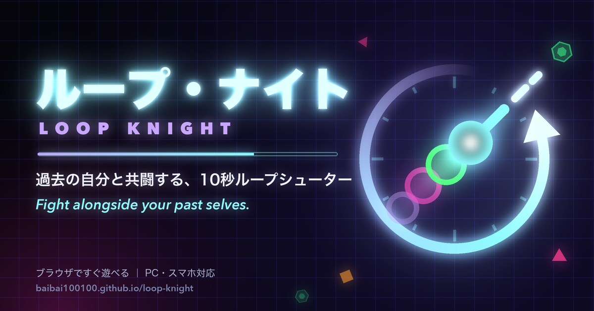

# ループ・ナイト / Loop Knight

**▶ 今すぐ遊ぶ / Play now: https://baibai100100.github.io/loop-knight/**

[日本語](#日本語) ・ [English](#english)

---

## 日本語

**過去の自分と共闘する、10秒ループシューター。**

10秒ごとに時間が巻き戻り、直前のループの自分が「ゴースト」になって同じ動き・同じ射撃を繰り返します。
ループを重ねるほど味方は増えるけれど、敵も増えていく。過去の自分たちと息を合わせて、どこまで生き延びられるか。

### 遊び方

| | PC | スマホ |
|---|---|---|
| 移動 | WASD / 矢印キー | 画面の左半分をドラッグ |
| 照準 | マウス | 画面の右半分をドラッグ |
| 射撃 | クリック（長押しで連射） | 右半分を押している間は自動射撃 |
| 一時停止 | P キー | 右上の一時停止ボタン |

- スマホは**横向き**で遊んでください。
- 10秒生き延びるとループクリア。今の自分の動きが次のループからゴーストとして戦ってくれます。

### 特徴

- **ゴーストとの共闘** — 過去のループの自分（最大8体）が同じ動きで敵を撃ち続ける。ゴーストが倒した敵はボーナス得点。
- **アップグレード・ドラフト** — ループクリアごとに3枚のカードから1つを選択。強化は**過去の自分（ゴースト）にも適用**される。
- **ループをまたぐボス** — 5ループごとに出現。HPは巻き戻っても持ち越し。ゴーストの集中砲火で削りきれ。
- **インストールしてオフラインで遊べる（PWA）** — ホーム画面に追加すればアプリのように全画面で起動し、一度読み込めば通信なしでも遊べる。

### ホーム画面に追加する

- **iPhone / iPad（Safari）**: 共有ボタン →「ホーム画面に追加」
- **Android（Chrome）**: 右上のメニュー（⋮）→「アプリをインストール」または「ホーム画面に追加」
- **PC（Chrome / Edge）**: アドレスバー右端のインストールアイコンをクリック

### 技術

- 素の JavaScript だけで作った単一ページのゲーム。ライブラリ・ビルド工程・外部依存なし。
- Canvas 2D 描画、固定タイムステップ（60Hz）、入力の記録と再生によるゴースト。
- 効果音・BGM は WebAudio による手続き生成（音声ファイルなし）。
- Service Worker によるオフライン対応（HTML はネットワーク優先で常に最新版を取得）。

### ライセンス

[MIT License](LICENSE) © 2026 BaiBai100100

---

## English

**Fight alongside your past selves — a 10-second time-loop arena shooter.**

Every 10 seconds, time rewinds and your previous run comes back as a **ghost** that replays your exact moves and shots.
Each loop adds another ally — and more enemies. Sync up with your past selves and see how long you can survive.

### How to play

| | PC | Phone |
|---|---|---|
| Move | WASD / arrow keys | Drag on the left half of the screen |
| Aim | Mouse | Drag on the right half of the screen |
| Fire | Click (hold for auto-fire) | Auto-fires while the right half is held |
| Pause | P | Pause button (top right) |

- On phones, play in **landscape**.
- Survive 10 seconds to clear the loop. What you just did becomes a ghost that fights with you from the next loop on.

### Features

- **Ghost co-op** — up to 8 past selves replay their runs and keep shooting. Ghost kills earn bonus points.
- **Upgrade draft** — after each loop, pick 1 of 3 cards. Upgrades **apply to your ghosts too**.
- **Cross-loop boss** — appears every 5 loops and keeps its HP across rewinds. Wear it down with your ghost squad.
- **Installable & offline (PWA)** — add it to your home screen to launch full-screen like an app; once loaded it plays without a connection.

### Add to home screen

- **iPhone / iPad (Safari)**: Share button → "Add to Home Screen"
- **Android (Chrome)**: menu (⋮) → "Install app" or "Add to Home screen"
- **Desktop (Chrome / Edge)**: click the install icon at the right end of the address bar

### Tech

- Single-page game in vanilla JavaScript. No libraries, no build step, no dependencies.
- Canvas 2D rendering, fixed 60 Hz timestep, ghosts via recorded-input replay.
- Procedurally generated WebAudio sound and music (no audio files).
- Offline support via a Service Worker (HTML is network-first, so updates arrive right away).

### License

[MIT License](LICENSE) © 2026 BaiBai100100
